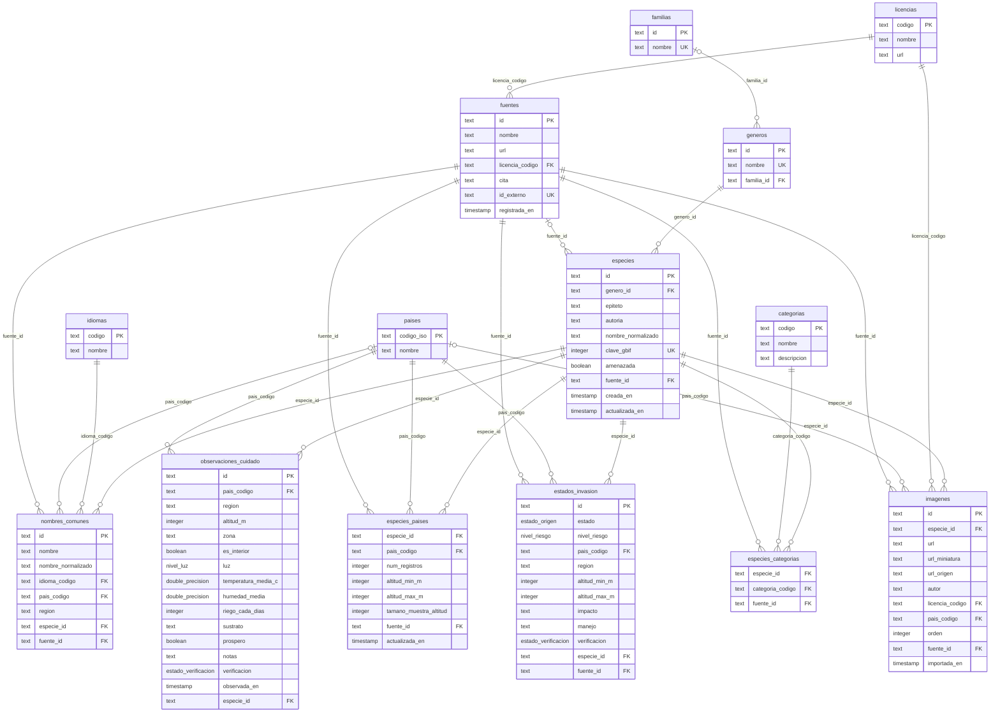

# Base de datos

> Documento **generado** desde `prisma/schema.prisma`. No lo edites a mano:
> cambia el esquema y ejecuta `pnpm docs:generate`.

Motor: PostgreSQL 17. Cómo conectarte con DBeaver: [DATABASE.md](../DATABASE.md).

## Diagrama entidad-relación

## Tablas

| Tabla | Modelo (código) | Descripción |
|---|---|---|
| [`idiomas`](#idiomas) | Language | Idiomas admitidos en los nombres comunes. Tabla de referencia. |
| [`paises`](#paises) | Country | Países. Tabla de referencia. |
| [`licencias`](#licencias) | License | Licencias abiertas admitidas. Tabla de referencia. Solo se permiten licencias que consienten uso comercial y redistribución. |
| [`fuentes`](#fuentes) | Source | Fuente de un dato (GBIF, un jardín botánico, una persona aportante...). |
| [`familias`](#familias) | Family | Familia botánica. |
| [`generos`](#generos) | Genus | Género botánico. Cada género pertenece a una familia. |
| [`especies`](#especies) | Species | Especie de planta. Una fila por especie aceptada, sin sinónimos. El nombre científico se arma con el género y el epíteto: "Bursera" + "simaruba". |
| [`especies_paises`](#especies_paises) | SpeciesCountry | Presencia de una especie en un país. La altitud depende del país (y del dato), por eso no vive en `especies`. |
| [`nombres_comunes`](#nombres_comunes) | CommonName | Un mismo nombre común puede designar especies distintas según el país, por eso se guarda con país y región. |
| [`estados_invasion`](#estados_invasion) | InvasionStatus | La invasión depende del lugar: una especie puede ser invasora en un piso térmico y no en otro. |
| [`observaciones_cuidado`](#observaciones_cuidado) | CareObservation | Experiencia real de cuidado, ligada al contexto donde ocurrió. Las recomendaciones se derivan de muchas observaciones, no de una sola. |
| [`categorias`](#categorias) | Category | Categoría de uso de una planta (fruta, hortaliza, flor...). Tabla de referencia. No incluye usos medicinales ni rituales (ver CONTENT_POLICY.md). |
| [`especies_categorias`](#especies_categorias) | SpeciesCategory | Categorías de una especie. Una misma especie puede estar en varias (el tomate es hortaliza y fruta; el maíz es cultivo y hortaliza). |
| [`imagenes`](#imagenes) | Image | Fotografía de una especie. Cada imagen guarda su autoría y su licencia propias (solo CC0 o CC-BY): la licencia de la imagen puede diferir de la de su registro. Se guarda el enlace, no el archivo: la imagen se sirve desde su origen. |

### idiomas

Idiomas admitidos en los nombres comunes. Tabla de referencia.

| Columna | Campo (código) | Tipo | Nulo | Clave | Por defecto | Descripción |
|---|---|---|---|---|---|---|
| `codigo` | `code` | text | no | PK |  | Código ISO 639-1: es, en, pt. |
| `nombre` | `name` | text | no |  |  | Nombre del idioma en español. |

### paises

Países. Tabla de referencia.

| Columna | Campo (código) | Tipo | Nulo | Clave | Por defecto | Descripción |
|---|---|---|---|---|---|---|
| `codigo_iso` | `isoCode` | text | no | PK |  | Código ISO 3166-1 alfa-2 en mayúsculas: CO, EC, PA, VE. |
| `nombre` | `name` | text | no |  |  | Nombre del país en español. |

### licencias

Licencias abiertas admitidas. Tabla de referencia. Solo se permiten licencias que consienten uso comercial y redistribución.

| Columna | Campo (código) | Tipo | Nulo | Clave | Por defecto | Descripción |
|---|---|---|---|---|---|---|
| `codigo` | `code` | text | no | PK |  | Código normalizado: `CC0-1.0` o `CC-BY-4.0`. |
| `nombre` | `name` | text | no |  |  | Nombre completo de la licencia. |
| `url` | `url` | text | no |  |  | Página con el texto de la licencia. |

### fuentes

Fuente de un dato (GBIF, un jardín botánico, una persona aportante...).

| Columna | Campo (código) | Tipo | Nulo | Clave | Por defecto | Descripción |
|---|---|---|---|---|---|---|
| `id` | `id` | text | no | PK | cuid (app) | Identificador interno (cuid). |
| `nombre` | `name` | text | no |  |  | Nombre de la fuente o del dataset. |
| `url` | `url` | text | sí |  |  | Página de la fuente. |
| `licencia_codigo` | `licenseCode` | text | no | FK → licencias.code |  | Licencia bajo la que se publica la fuente. |
| `cita` | `citation` | text | sí |  |  | Texto de citación sugerido por la fuente. |
| `id_externo` | `externalId` | text | sí | único |  | Identificador en el sistema de origen (p. ej. el UUID del dataset en GBIF). |
| `registrada_en` | `importedAt` | timestamp(3) | no |  | now() | Cuándo se registró esta fuente. |

Índices y restricciones:

- único: (`id_externo`)

### familias

Familia botánica.

| Columna | Campo (código) | Tipo | Nulo | Clave | Por defecto | Descripción |
|---|---|---|---|---|---|---|
| `id` | `id` | text | no | PK | cuid (app) | Identificador interno (cuid). |
| `nombre` | `name` | text | no | único |  | Nombre de la familia: "Orchidaceae". |

Índices y restricciones:

- único: (`nombre`)

### generos

Género botánico. Cada género pertenece a una familia.

| Columna | Campo (código) | Tipo | Nulo | Clave | Por defecto | Descripción |
|---|---|---|---|---|---|---|
| `id` | `id` | text | no | PK | cuid (app) | Identificador interno (cuid). |
| `nombre` | `name` | text | no | único |  | Nombre del género: "Bursera". |
| `familia_id` | `familyId` | text | sí | FK → familias.id |  | Familia a la que pertenece. |

Índices y restricciones:

- único: (`nombre`)
- índice: (`familia_id`)

### especies

Especie de planta. Una fila por especie aceptada, sin sinónimos. El nombre científico se arma con el género y el epíteto: "Bursera" + "simaruba".

| Columna | Campo (código) | Tipo | Nulo | Clave | Por defecto | Descripción |
|---|---|---|---|---|---|---|
| `id` | `id` | text | no | PK | cuid (app) | Identificador interno (cuid). |
| `genero_id` | `genusId` | text | no | FK → generos.id |  | Género de la especie (de aquí sale también la familia). |
| `epiteto` | `epithet` | text | no |  |  | Epíteto específico: "simaruba" en "Bursera simaruba". |
| `autoria` | `authorship` | text | sí |  |  | Autoría del nombre: "(G.Mey.) Hoehne". |
| `nombre_normalizado` | `nameNormalized` | text | no |  |  | Nombre científico en minúsculas y sin acentos, para búsquedas (dato derivado). |
| `clave_gbif` | `gbifKey` | integer | sí | único |  | Identificador de la especie en GBIF. |
| `amenazada` | `isThreatened` | boolean | no |  | `false` | Especie amenazada: sus coordenadas nunca se publican exactas. |
| `fuente_id` | `sourceId` | text | sí | FK → fuentes.id |  | Fuente de la taxonomía. |
| `creada_en` | `createdAt` | timestamp(3) | no |  | now() |  |
| `actualizada_en` | `updatedAt` | timestamp(3) | no |  |  |  |

Índices y restricciones:

- único: (`clave_gbif`)
- índice: (`nombre_normalizado`)
- único: (`genero_id`, `epiteto`)

### especies_paises

Presencia de una especie en un país. La altitud depende del país (y del dato), por eso no vive en `especies`.

| Columna | Campo (código) | Tipo | Nulo | Clave | Por defecto | Descripción |
|---|---|---|---|---|---|---|
| `especie_id` | `speciesId` | text | no | PK; FK → especies.id (ON DELETE CASCADE) |  | Especie. |
| `pais_codigo` | `countryCode` | text | no | PK; FK → paises.isoCode |  | País. |
| `num_registros` | `occurrenceCount` | integer | no |  |  | Registros abiertos (CC0/CC-BY) en GBIF para este país. |
| `altitud_min_m` | `minElevationM` | integer | sí |  |  | Altitud mínima del rango central observado (percentil 5), en m s. n. m. |
| `altitud_max_m` | `maxElevationM` | integer | sí |  |  | Altitud máxima del rango central observado (percentil 95), en m s. n. m. |
| `tamano_muestra_altitud` | `elevationSampleSize` | integer | sí |  |  | Cuántos registros con altitud se usaron para calcular el rango. |
| `fuente_id` | `sourceId` | text | no | FK → fuentes.id |  | Fuente de los datos de presencia. |
| `actualizada_en` | `updatedAt` | timestamp(3) | no |  |  |  |

Índices y restricciones:

- índice: (`pais_codigo`)

Clave primaria compuesta: (`speciesId`, `countryCode`)

### nombres_comunes

Un mismo nombre común puede designar especies distintas según el país, por eso se guarda con país y región.

| Columna | Campo (código) | Tipo | Nulo | Clave | Por defecto | Descripción |
|---|---|---|---|---|---|---|
| `id` | `id` | text | no | PK | cuid (app) | Identificador interno (cuid). |
| `nombre` | `name` | text | no |  |  | Tal como se muestra al usuario. |
| `nombre_normalizado` | `nameNormalized` | text | no |  |  | Minúsculas, sin acentos, espacios colapsados (dato derivado para búsquedas). |
| `idioma_codigo` | `languageCode` | text | no | FK → idiomas.code | `es` | Idioma del nombre. |
| `pais_codigo` | `countryCode` | text | sí | FK → paises.isoCode |  | País, solo si la fuente lo indica; si no, null (no se asume país). |
| `region` | `region` | text | sí |  |  | Región o departamento, si se conoce. |
| `especie_id` | `speciesId` | text | no | FK → especies.id (ON DELETE CASCADE) |  | Especie a la que designa el nombre. |
| `fuente_id` | `sourceId` | text | no | FK → fuentes.id |  | Fuente (con su licencia) de donde viene el nombre. |

Índices y restricciones:

- índice: (`nombre_normalizado`)
- único: (`especie_id`, `nombre_normalizado`, `idioma_codigo`, `fuente_id`)

### estados_invasion

La invasión depende del lugar: una especie puede ser invasora en un piso térmico y no en otro.

| Columna | Campo (código) | Tipo | Nulo | Clave | Por defecto | Descripción |
|---|---|---|---|---|---|---|
| `id` | `id` | text | no | PK | cuid (app) | Identificador interno (cuid). |
| `estado` | `status` | enum estado_origen | no |  |  | Nativa, introducida o invasora en este lugar. |
| `nivel_riesgo` | `riskLevel` | enum nivel_riesgo | sí |  |  | Riesgo ecológico, si se conoce. |
| `pais_codigo` | `countryCode` | text | no | FK → paises.isoCode |  | País. |
| `region` | `region` | text | sí |  |  | Región o departamento, si aplica. |
| `altitud_min_m` | `minElevationM` | integer | sí |  |  | Altitud mínima donde aplica el estatus (m s. n. m.). |
| `altitud_max_m` | `maxElevationM` | integer | sí |  |  | Altitud máxima donde aplica el estatus (m s. n. m.). |
| `impacto` | `impact` | text | sí |  |  | Daño que causa al ecosistema. |
| `manejo` | `management` | text | sí |  |  | Recomendación de manejo o control. |
| `verificacion` | `verification` | enum estado_verificacion | no |  | `REPORTED` | Nivel de verificación del dato. |
| `especie_id` | `speciesId` | text | no | FK → especies.id (ON DELETE CASCADE) |  | Especie a la que se refiere. |
| `fuente_id` | `sourceId` | text | no | FK → fuentes.id |  | Fuente del dato (debe ser una lista verificable). |

Índices y restricciones:

- índice: (`pais_codigo`, `estado`)

### observaciones_cuidado

Experiencia real de cuidado, ligada al contexto donde ocurrió. Las recomendaciones se derivan de muchas observaciones, no de una sola.

| Columna | Campo (código) | Tipo | Nulo | Clave | Por defecto | Descripción |
|---|---|---|---|---|---|---|
| `id` | `id` | text | no | PK | cuid (app) | Identificador interno (cuid). |
| `pais_codigo` | `countryCode` | text | no | FK → paises.isoCode |  | País. |
| `region` | `region` | text | sí |  |  | Región o departamento. |
| `altitud_m` | `elevationM` | integer | sí |  |  | Altitud del lugar de cultivo (m s. n. m.). |
| `zona` | `zoneCode` | text | sí |  |  | Ubicación generalizada (nunca coordenadas exactas). |
| `es_interior` | `isIndoor` | boolean | sí |  |  | true si la planta estaba en interior. |
| `luz` | `light` | enum nivel_luz | sí |  |  | Luz que recibía la planta. |
| `temperatura_media_c` | `avgTempC` | double precision | sí |  |  | Temperatura media del lugar (°C). |
| `humedad_media` | `avgHumidity` | double precision | sí |  |  | Humedad relativa media del lugar (%). |
| `riego_cada_dias` | `wateringEveryDays` | integer | sí |  |  | Cada cuántos días se regaba. |
| `sustrato` | `substrate` | text | sí |  |  | Sustrato usado. |
| `prospero` | `thrived` | boolean | sí |  |  | true si la planta prosperó con esta práctica. |
| `notas` | `notes` | text | sí |  |  | Notas libres de la persona que aporta. |
| `verificacion` | `verification` | enum estado_verificacion | no |  | `REPORTED` | Nivel de verificación del dato. |
| `observada_en` | `observedAt` | timestamp(3) | no |  | now() | Cuándo ocurrió la observación. |
| `especie_id` | `speciesId` | text | no | FK → especies.id (ON DELETE CASCADE) |  | Especie observada. |

Índices y restricciones:

- índice: (`especie_id`, `pais_codigo`)

### categorias

Categoría de uso de una planta (fruta, hortaliza, flor...). Tabla de referencia. No incluye usos medicinales ni rituales (ver CONTENT_POLICY.md).

| Columna | Campo (código) | Tipo | Nulo | Clave | Por defecto | Descripción |
|---|---|---|---|---|---|---|
| `codigo` | `code` | text | no | PK |  | Código estable: FRUTA, HORTALIZA, CULTIVO, FLOR. |
| `nombre` | `name` | text | no |  |  | Nombre en español. |
| `descripcion` | `description` | text | no |  |  | Qué incluye la categoría. |

### especies_categorias

Categorías de una especie. Una misma especie puede estar en varias (el tomate es hortaliza y fruta; el maíz es cultivo y hortaliza).

| Columna | Campo (código) | Tipo | Nulo | Clave | Por defecto | Descripción |
|---|---|---|---|---|---|---|
| `especie_id` | `speciesId` | text | no | PK; FK → especies.id (ON DELETE CASCADE) |  | Especie. |
| `categoria_codigo` | `categoryCode` | text | no | PK; FK → categorias.code |  | Categoría. |
| `fuente_id` | `sourceId` | text | no | FK → fuentes.id |  | Fuente de la clasificación. |

Índices y restricciones:

- índice: (`categoria_codigo`)

Clave primaria compuesta: (`speciesId`, `categoryCode`)

### imagenes

Fotografía de una especie. Cada imagen guarda su autoría y su licencia propias (solo CC0 o CC-BY): la licencia de la imagen puede diferir de la de su registro. Se guarda el enlace, no el archivo: la imagen se sirve desde su origen.

| Columna | Campo (código) | Tipo | Nulo | Clave | Por defecto | Descripción |
|---|---|---|---|---|---|---|
| `id` | `id` | text | no | PK | cuid (app) | Identificador interno (cuid). |
| `especie_id` | `speciesId` | text | no | FK → especies.id (ON DELETE CASCADE) |  | Especie fotografiada. |
| `url` | `url` | text | no |  |  | Enlace a la imagen (tamaño grande, para mostrar). |
| `url_miniatura` | `thumbnailUrl` | text | sí |  |  | Enlace a una versión pequeña (listas y tarjetas), si el origen la ofrece. |
| `url_origen` | `pageUrl` | text | sí |  |  | Página del origen donde está la foto (para atribuir y verificar). |
| `autor` | `author` | text | no |  |  | Persona autora o titular de los derechos. Obligatoria: CC-BY exige atribución. |
| `licencia_codigo` | `licenseCode` | text | no | FK → licencias.code |  | Licencia de esta imagen. |
| `pais_codigo` | `countryCode` | text | sí | FK → paises.isoCode |  | País donde se tomó la foto, si se conoce. |
| `orden` | `position` | integer | no |  | `0` | Posición al mostrar: 0 es la imagen principal. |
| `fuente_id` | `sourceId` | text | no | FK → fuentes.id |  | Fuente de la que se obtuvo (GBIF). |
| `importada_en` | `importedAt` | timestamp(3) | no |  | now() |  |

Índices y restricciones:

- índice: (`especie_id`, `orden`)
- único: (`especie_id`, `url`)

## Enumeraciones

### estado_verificacion

Nivel de verificación de un dato.

Enumeración del código: `VerificationStatus`.

- `REPORTADO` (código: `REPORTED`): Reportado por una persona; aún sin corroborar.
- `CORROBORADO` (código: `CORROBORATED`): Varios reportes independientes coinciden.
- `VERIFICADO_EXPERTO` (código: `EXPERT_VERIFIED`): Verificado por un experto o una institución.

### estado_origen

Estatus de una especie en un lugar.

Enumeración del código: `OriginStatus`.

- `NATIVA` (código: `NATIVE`): Nativa de la región.
- `INTRODUCIDA` (código: `INTRODUCED`): Introducida por el ser humano, sin daño documentado.
- `INVASORA` (código: `INVASIVE`): Introducida y con daño documentado a ecosistemas locales.

### nivel_riesgo

Nivel de riesgo ecológico de una especie invasora.

Enumeración del código: `RiskLevel`.

- `BAJO` (código: `LOW`)
- `MEDIO` (código: `MEDIUM`)
- `ALTO` (código: `HIGH`)

### nivel_luz

Nivel de luz donde se cultivó la planta.

Enumeración del código: `LightLevel`.

- `SOL_PLENO` (código: `FULL_SUN`): Sol directo la mayor parte del día.
- `MEDIA_SOMBRA` (código: `PARTIAL_SHADE`): Sol parte del día y sombra el resto.
- `SOMBRA` (código: `SHADE`): Poca luz directa.

## Historial de migraciones

Cada cambio en las tablas queda en `prisma/migrations/`, en orden cronológico:

- `20261012213955_init`
- `20261012221637_gbif_import_model`
- `20261012231032_tercera_forma_normal_en_espanol`
- `20261012235000_categorias_e_imagenes`
